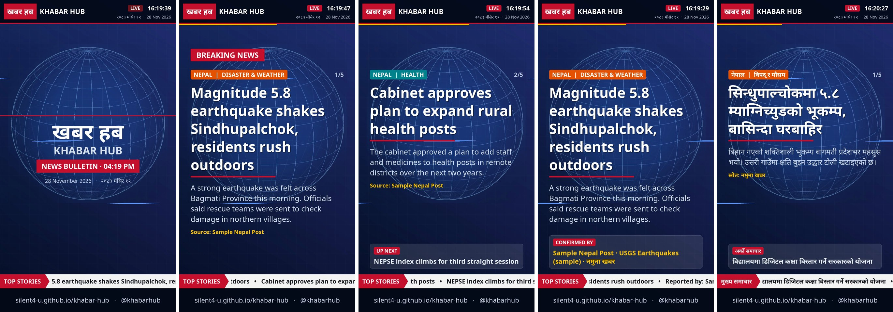

# खबर हब · Khabar Hub

A news website that runs itself. Every 15 minutes it:

1. **Collects** headlines from Nepali and world news feeds (16 to start with, in
   `feeds.yaml`), plus the official USGS earthquake and GDACS disaster feeds.
2. **Sorts** them into Nepal / World and seven sections: politics, economy,
   disaster & weather, sports, technology, health and entertainment. It uses
   English and Nepali keywords, or Claude when an API key is set. Claude also
   writes a short summary in English and Nepali for each story.
3. **Spots emergencies.** An emergency is posted when at least two different
   sources report the same event, or an official feed does: a strong quake near
   Nepal, a GDACS red or orange alert.
4. **Makes news-channel videos** in vertical 1080×1920 for YouTube Shorts,
   TikTok, Facebook Reels and Instagram Reels. Each video has:
   - an intro sting;
   - a live clock and the Bikram Sambat date;
   - a BREAKING banner, the headline and summary, and a scrolling ticker;
   - a natural narrating voice over a music bed.
5. **Posts** a bulletin four times a day (06:00, 12:00, 17:00, 21:00 Nepal time;
   add more in `config.yaml`) and every confirmed emergency at once.
6. **Rebuilds the website.** The site is in English and नेपाली with a
   one-tap switch and a page per section, and it shows the latest videos and a
   JSON feed.



The site shows headlines, short summaries and links to the original articles.
It never copies whole articles or photos. The videos use text only, with no
footage from news sites.

## Try it on your computer

```bash
sudo apt install ffmpeg fonts-noto-core espeak-ng libraqm0     # macOS: brew install ffmpeg espeak-ng libraqm
pip install -r requirements.txt

python -m newshub run --samples --bulletin    # made-up sample news; no internet needed
python -m newshub run --bulletin              # real feeds
```

Open `site/index.html` in a browser. Videos are written to `data/videos/`.
Nothing is posted unless you add `--publish`; without it, each post is printed.

Other options:
- `--no-video`: skip the videos (fast).
- `--no-ai`: keyword rules only.

## Put it online (free, on GitHub)

The news hub runs from this repository (`silent4-u/Manish8u`), in the
`news-hub/` folder. Its website becomes this repository's GitHub Pages site,
`https://silent4-u.github.io/Manish8u/`.

1. **Turn on Pages.** Go to the repository's Settings > Pages >
   Build and deployment and set Source to **GitHub Actions**.
2. **Add the workflow.** Copy `news-hub/deploy/news-hub.yml` to
   `.github/workflows/news-hub.yml`. Then merge it into the default branch,
   because GitHub runs scheduled workflows only from there.
3. **Edit `config.yaml`.**
   - `site.base_url`: the Pages address. It is already set for this repository.
   - `site.name` and `name_ne`: the channel's name.
   - `video.handles`: your social handle.
4. **Add the secrets** for the platforms you want (below) under
   Settings > Secrets and variables > Actions. A platform without its
   secrets is skipped.
5. **Test it.** Go to Actions > News Hub > Run workflow, tick "Make a bulletin
   now" and untick "Really post". The log shows each post it would make, and the
   site appears at your Pages address.

From then on it runs every 15 minutes by itself. Two things to know:
- GitHub often starts scheduled runs 5–30 minutes late. A bulletin is made by the
  first run up to 60 minutes after its time.
- GitHub pauses scheduled workflows in a repository with no commits for 60 days,
  and sends you an email first. Re-enable the workflow from the Actions tab.

## Connecting the platforms

Run the login helpers **on your own computer**. They print the tokens there.
Paste them only into the repository's secrets.

### YouTube (Shorts)

1. In [Google Cloud Console](https://console.cloud.google.com/), create a project
   and enable **YouTube Data API v3**.
2. Under APIs & Services > OAuth consent screen, set it up as External and add
   the `youtube.upload` scope. Then set the publishing status to **In production**.
   In "Testing", the login stops working after 7 days.
3. Under Credentials, create an OAuth client ID of type **Desktop app**.
4. Run `python -m newshub auth youtube` and log in with the channel's account.
5. Save these secrets: `YT_CLIENT_ID`, `YT_CLIENT_SECRET`, `YT_REFRESH_TOKEN`.

Limits:
- Uploads from a new, unverified API project are **private** until Google's API
  audit approves the project. Apply for it from the console.
- The default quota of 10,000 units a day covers about 6 uploads (check the
  current costs). Ask for more in the console if you add bulletins.

### TikTok

1. At [developers.tiktok.com](https://developers.tiktok.com/), create an app
   with **Login Kit** and the **Content Posting API**.
2. Add the scopes `user.info.basic`, `video.upload` and `video.publish`.
3. Add the redirect URI `https://<user>.github.io/<repo>/auth.html`. The site
   includes that page; it shows the login code.
4. Run `python -m newshub auth tiktok`.
5. Save these secrets: `TIKTOK_CLIENT_KEY`, `TIKTOK_CLIENT_SECRET`,
   `TIKTOK_REFRESH_TOKEN`. The token lasts a year; run the helper again before then.

Choose a mode in `config.yaml`:
- `mode: direct` posts at once. Until TikTok audits the app, those posts are
  visible **only to you**. The audit checks how creators review posts, and a
  fully automatic poster may not pass it.
- `mode: draft` sends each video to the TikTok app's inbox, where you add
  sounds or edits and tap post. It needs no audit.

### Facebook Page and Instagram (Reels)

You need a Facebook **Page**. For Instagram, you also need an Instagram
**professional** account (Business or Creator) linked to that Page.

1. At [developers.facebook.com](https://developers.facebook.com/), create an app
   of type Business.
2. In the [Graph API Explorer](https://developers.facebook.com/tools/explorer/),
   pick your app and generate a user token with these permissions:
   - `pages_show_list`
   - `pages_read_engagement`
   - `pages_manage_posts`
   - `publish_video`
   - `business_management`
   - for Instagram: `instagram_basic` and `instagram_content_publish`
3. Run `python -m newshub auth facebook` and paste in the app ID, the app
   secret and that token.
4. Save these secrets: `FB_PAGE_ID`, `FB_PAGE_TOKEN` and, if Instagram is
   linked, `IG_USER_ID`.

The Page token doesn't expire. While the app is in development mode it can post
to Pages you manage; Meta's app review is needed only to post for other people.
Instagram caps how many posts an account can publish through the API each day.

### The narrating voice

Videos are narrated by a natural-sounding voice, never a robotic one:

- **Piper** (free, the default) downloads its voices from Hugging Face on the
  first run and keeps them cached. English uses `en_US-ryan-high` and Nepali uses
  `ne_NP-google-medium`. You can change them under `video.voice.piper` in
  `config.yaml`; the [voice samples](https://rhasspy.github.io/piper-samples/)
  page lets you listen first.
- **Azure neural voices** sound the most like a TV newsreader and include
  real Nepali voices: `ne-NP-SagarNeural` (male) and `ne-NP-HemkalaNeural`
  (female). Azure has a free monthly allowance that easily covers four
  bulletins a day.
  1. In the [Azure portal](https://portal.azure.com/), create a **Speech**
     resource. The free F0 tier is enough.
  2. Save its key and region (e.g. `centralindia`) as the secrets
     `AZURE_SPEECH_KEY` and `AZURE_SPEECH_REGION`.

  When those secrets are set, Azure is used automatically.

If no natural voice is available, the video has music and on-screen text only.
Set `video.voice.allow_robotic: true` to use the robotic espeak-ng voice instead.

### Optional

- **Telegram**: create a bot with @BotFather and add it to your channel as an
  admin. Then set `telegram.enabled: true` and save `TELEGRAM_BOT_TOKEN` and
  `TELEGRAM_CHAT_ID` (e.g. `@yourchannel`). `TELEGRAM_ADMIN_CHAT_ID` is where
  review mode sends alerts.
- **X**: set `x.enabled: true` and save `X_API_KEY`, `X_API_SECRET`,
  `X_ACCESS_TOKEN` and `X_ACCESS_SECRET`. Posting through X's API may need a
  paid plan.
- **Claude**: save `ANTHROPIC_API_KEY` (from
  [console.anthropic.com](https://console.anthropic.com/)). Claude then sorts
  stories, judges emergencies and writes the English and Nepali summaries
  and headlines. Without it, keyword rules sort the stories and the site uses the
  feeds' own teasers. Settings are under `ai:` in `config.yaml`.

## Settings worth knowing (`config.yaml`)

| Setting | What it does |
| --- | --- |
| `bulletins.times` | When bulletins go out (Nepal time). Add more for more bulletins. |
| `bulletins.stories`, `nepal_stories` | How many stories per bulletin, and how many of them from Nepal. |
| `emergency.mode` | `auto`: post confirmed alerts at once. `review`: send them to the admin Telegram chat for a person to check. |
| `emergency.min_sources` | How many different sources must report an event before it is posted. |
| `emergency.usgs_nepal_magnitude` | Quakes near Nepal at least this strong are alerted. |
| `video.language` | `en` or `ne`: narration and on-screen text. Nepali needs Claude for translated headlines. |
| `video.voice` | Which voice narrates (Azure or Piper), its speed, and whether a robotic fallback is allowed. |
| `video.formats` | `vertical` (Reels, Shorts, TikTok) and/or `horizontal` (1920×1080). |
| `categories` | Sections and their English/Nepali keywords. |

Feeds are listed in `feeds.yaml`. To add one, give it a name, URL, region
(`nepal` or `world`) and language (`en` or `ne`).

## How emergency alerts work

A story becomes a candidate in either of these cases:
- its headline names an emergency (earthquake, flood, landslide, भूकम्प, बाढी,
  पहिरो…), or Claude judges it one;
- USGS or GDACS reports it.

Candidates that describe the same event are grouped: they share headline words,
or they report a quake in the same region, even across languages.

A group is posted when either:
- at least `min_sources` different sources carry it, or
- an official feed is in it.

Each event is posted once. A single unconfirmed report waits for a second
source. Use `mode: review` if every alert should be checked by a person first.

## Before going live

- **Respect publishers.** Use headlines, short summaries and links only, which
  this does. Read each feed's terms, and remove any source that objects.
- **Register as online media.** Online news media operating in Nepal are
  expected to register with the Department of Information and Broadcasting.
  Check the current rules before you publish under a channel name.
- **Check the alerts.** Automatic emergency posts can be wrong. Start with
  `emergency.mode: review` until you trust them, and never add facts the
  sources don't state.
- **Follow platform rules.** Each platform has rules on automated and
  news content. Keep the accounts' contact details and the "about" text honest.

## Files

```
newshub/collect.py   fetch and parse the feeds (RSS/Atom, USGS, GDACS)
newshub/classify.py  sections, Nepal/World, emergency detection, ranking
newshub/ai.py        Claude: categories, emergency judgement, summaries (optional)
newshub/video.py     the news-channel videos (Pillow frames + ffmpeg)
newshub/tts.py       narration: Azure or Piper neural voices
newshub/publish.py   YouTube, TikTok, Facebook, Instagram, Telegram, X
newshub/site.py      the website (templates in newshub/templates/)
newshub/auth.py      one-time logins that print the tokens
deploy/news-hub.yml  the GitHub Actions workflow
```
